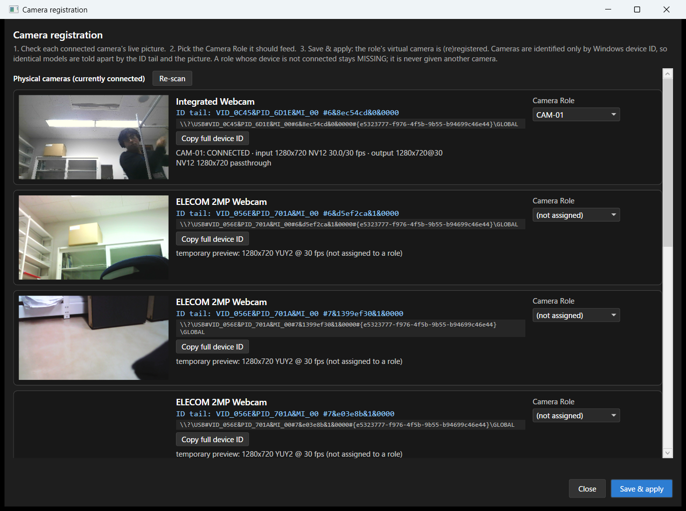
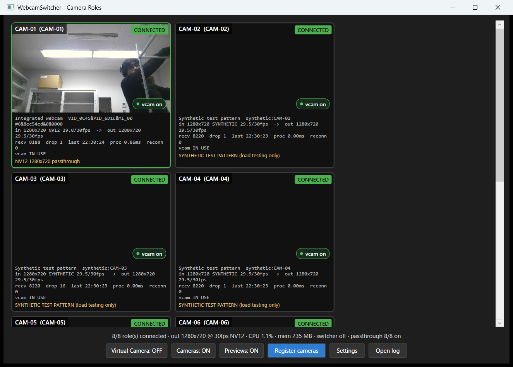
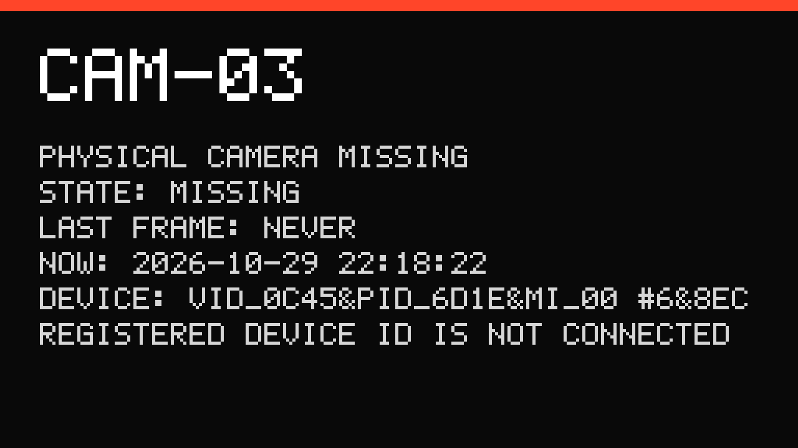

# WebcamSwitcher Camera Roles 運用ガイド

同型の USB Web カメラを複数台つないでも、各カメラを **固定名の仮想カメラ `CAM-01`、`CAM-02`、…** として
TouchDesigner や MediaPipe TouchDesigner プラグインから使えるようにするための手順書です。

- 物理カメラは **Windows のデバイス ID(シンボリックリンク)だけ**で識別します。
  列挙順・Device Index・Friendly Name・「最初に見つかったカメラ」は使いません。
- 物理カメラ → **Camera Role**(`CAM-01` など)→ そのロール専用の映像パイプ → そのロール専用の仮想カメラ、
  という対応を、配列の位置ではなくロールで管理します。
- 登録したデバイス ID が見つからないロールは **MISSING** になり、別のカメラへは絶対に切り替わりません。

> 対象: Windows 11(x64)。管理者権限が必要なのはインストール(COM 登録)の 1 回だけです。

---

## 1. 導入手順

### 1.1 インストーラーを使う(推奨)

1. `WebcamSwitcher-Setup-<version>.exe` を実行します(UAC で管理者権限を許可)。
   - `C:\Program Files\WebcamSwitcher\` にインストールされ、仮想カメラのメディアソース
     (`WebcamSwitcher.Source.dll`)が COM 登録(`regsvr32`)されます。
   - 「Run WebcamSwitcher at Windows sign-in」にチェックすると、ログイン時に自動起動します
     (アプリの設定画面からも変更できます)。
2. インストール完了後、WebcamSwitcher が起動します。初回はロールが 1 つもないため、
   **カメラ登録画面** が自動で開きます(→ 2 章)。

### 1.2 portable 版を使う

1. `WebcamSwitcher-<version>-portable.zip` を **ユーザープロファイルの外**(例: `C:\WebcamSwitcher\` か
   `C:\Program Files\WebcamSwitcher\`)に展開します。
   - 仮想カメラ DLL は Windows の Frame Server(LOCAL SERVICE 権限)が読み込むため、
     `Documents` や `Desktop` など**ユーザープロファイル配下に置くと仮想カメラが動きません**。
2. 管理者のコマンドプロンプトで 1 回だけ COM 登録します。
   ```
   regsvr32 "C:\WebcamSwitcher\WebcamSwitcher.Source.dll"
   ```
3. `WebcamSwitcher.exe` を起動します。

### 1.3 必要な環境

- Windows 11 22H2 以降(`MFCreateVirtualCamera` が必要)
- .NET ランタイムは不要(self-contained)
- 同型カメラを多数使う場合は **USB ホストコントローラーの数** に注意(→ 6 章)

---

## 2. カメラ登録手順

メイン画面の **Register cameras**(またはトレイメニューの「Camera registration」)を開きます。



1. **現在接続されている物理カメラを列挙**: 画面上部に、いま接続されている物理カメラが 1 台ずつ表示されます
   (仮想カメラは除外)。カメラを差し直したら **Re-scan** を押します。
2. **映像を確認**: 各行の左側にライブ映像が出ます。同じ「ELECOM 2MP Webcam」のように Friendly Name が
   同じでも、**ID tail**(例: `VID_056E&PID_701A&MI_00 #6&d5ef2ca&1&0000`)と映像で区別できます。
   - 手でカメラを覆う・指差すなどして、どの行がどの物理カメラか確認してください。
   - **Copy full device ID** で完全なデバイス ID をクリップボードへコピーできます。
3. **Camera Role を割り当て**: 右側の「Camera Role」で `CAM-01` などを選びます。
   ロールが足りなければ下段の **+ Add role** で追加します(上限はありません。CAM-09、CAM-10、… と増やせます)。
4. **設定を保存**: **Save & apply** を押すと、検証のうえ設定ファイルへ保存されます。
5. **仮想カメラを登録**: 保存と同時に、そのロールの仮想カメラ(`CAM-01` など)が登録・開始されます。

### 登録の制約(自動で検査されます)

| 内容 | 結果 |
|---|---|
| 同じ物理 Device ID を 2 つのロールへ | 保存できません |
| 同じ Virtual Camera Name を 2 つのロールへ(大文字小文字の違いも同一扱い) | 保存できません |
| 同じ Virtual Camera ID を 2 つのロールへ | 保存できません |
| 同じ Camera Role 名を 2 つ | 保存できません |
| 手編集で上記の重複が入った設定ファイル | 該当ロールは **DUPLICATED** になり仮想カメラを登録しません |

### ロール名・仮想カメラ名の変更

ロール一覧(画面下段)で Role / Virtual Camera Name を変更して保存すると、そのロールだけ次の順で処理されます。

1. 古い仮想カメラを停止 → 2. 古い登録を解除 → 3. 新しい名前で登録 → 4. 設定を更新

他のロールの仮想カメラ・取得は止まりません。Virtual Camera ID(内部の永続 ID)は変わりません。

### 物理カメラを別の USB ポートへ移した場合

シリアル番号を持たない一般的な UVC カメラは、Windows のデバイス ID に **接続ポートの位置** が含まれます。
別ポートへ移すとデバイス ID が変わり、次のようになります。

- 元のロール(例: `CAM-01`)は **MISSING** のまま(別のカメラへは自動で割り当てません)。
- 移したカメラは登録画面に「(not assigned)」の新しいカメラとして表示されます。
- 登録画面でそのカメラを `CAM-01` に割り当て直して保存してください(再登録)。

シリアル番号を持つカメラはポートを変えても ID が変わらないため、そのまま同じロールに戻ります。

---

## 3. 展示時の起動手順

### 3.1 推奨設定(Settings 画面)

| 項目 | 推奨 | 説明 |
|---|---|---|
| Start at Windows sign-in | ON | ログイン時に自動起動 |
| Start minimized to the tray | ON | ウィンドウを出さずトレイで起動 |
| Start camera capture automatically | ON | 起動時にカメラ取得を開始 |
| Register the enabled role virtual cameras automatically | ON | 起動時に仮想カメラを登録 |
| Restart automatically after a crash or hang | ON | Windows の再起動マネージャーで再起動(起動後 60 秒以上経過している場合) |
| Reconnect: Startup wait | 15000〜30000 ms | 冷間起動で USB カメラの認識が遅れても、その間は MISSING ではなく CONNECTING と表示 |
| Reconnect: Retry forever | ON | 抜けたカメラを同じ ID で待ち続ける |
| Previews | OFF(メイン画面のボタン) | プレビュー描画を止めて CPU を節約。仮想カメラは動き続けます |
| Switcher virtual camera | OFF | 今回の用途では不要(既定 OFF) |

Windows の自動ログオンを使う場合は、そのユーザーで WebcamSwitcher を自動起動にしてください
(仮想カメラはログオン中のセッションでのみ列挙されます)。

### 3.2 起動時に行われること

1. 設定ファイルを読み込む(壊れていればバックアップから復元)
2. 現在の物理カメラを列挙する(DeviceWatcher)
3. Device ID で登録済みカメラを照合し、結果をログへ書く
4. 各ロールの状態を確認する
5. 各ロールの仮想カメラ(`CAM-01` …)を登録する — **カメラがまだ無くても登録**され、診断映像を出します
6. 物理カメラの取得を開始する(各ロール独立・並列)
7. 仮想カメラへの映像送信を開始する

列挙順には一切依存しません。

### 3.3 TouchDesigner / MediaPipe プラグインでの選択

- MediaPipe TouchDesigner プラグインの Webcam メニューには、Chromium が返すラベル
  `CAM-01 (Windows 仮想カメラ)` のように表示されます(英語版 Windows では `CAM-01 (Windows Virtual Camera)`)。
- プラグインは **ラベルの完全一致**でカメラを探し、`deviceId: {exact}` で開きます。ロール名が固定なので
  再起動後も同じ項目を選べば同じ物理カメラになります。
- **物理カメラ(例: 「ELECOM 2MP Webcam」)を直接選ばないでください。** WebcamSwitcher が排他的に取得中のため開けません。
- 1 つの `CAM-xx` は 1 つのアプリ(1 プロセス)から使ってください。2 つ目のアプリが同じ `CAM-xx` を
  排他モードで開くとフレームが届きません(共有モードなら受信できますが遅延が増えます)。

### 3.4 状態の見方(メイン画面)



各タイルにロール、状態バッジ、Friendly Name、Device ID 末尾、入力解像度/fps/ピクセル形式、出力解像度/fps、
受信フレーム数、ドロップ数、最終受信時刻、処理時間、再接続回数、仮想カメラの利用状態(IN USE / idle / off)
を表示します。画面下部に全体の CPU 使用率とメモリ使用量を表示します。

| 状態 | 意味 |
|---|---|
| UNASSIGNED | ロールに物理カメラが登録されていない |
| CONNECTING | 起動直後・デバイス認識待ち・初回オープン中 |
| CONNECTED | 映像が流れている |
| MISSING | 登録した Device ID が接続されていない(抜けた/別ポート) |
| RECONNECTING | 一度つながったカメラを同じ ID で再オープン中 |
| NO SIGNAL | デバイスは開いたがフレームが届かない |
| FORMAT ERROR | フォーマット交渉に失敗した |
| VIRTUAL CAMERA STOPPED | カメラは正常だが、そのロールの仮想カメラがオフ |
| DUPLICATED | ロール/名前/ID/デバイスの重複がある |
| ERROR | 開けない(他アプリ使用中、権限、USB 帯域不足など。詳細は 2 行目) |

カメラから映像が来ていない間、仮想カメラには次のような**診断映像**が出ます(ロール名、状態、最終受信時刻、現在時刻、デバイス ID 末尾、理由)。



---

## 4. トラブルシューティング

まず **Open log**(メイン画面)でログフォルダ `%LOCALAPPDATA%\WebcamSwitcher\logs\` を開き、
`WebcamSwitcher.log` を確認します。行は `日時 [CAM-01] メッセージ` の形式です。

| 症状 / 状態 | 確認すること |
|---|---|
| アプリやブラウザに `CAM-xx` が出てこない | ログに `media source not registered` / `registration is stale` があれば COM 登録をやり直す(`regsvr32`、管理者)。DLL がユーザープロファイル配下にないか確認。仮想カメラの OFF スイッチ(タイル右下)を確認 |
| MISSING | 物理カメラが抜けている、または別の USB ポートに挿されている(デバイス ID が変わる)。同じポートへ挿し直すと自動復帰。別ポートなら登録画面で再登録 |
| ERROR「USB BANDWIDTH INSUFFICIENT」 / ログに `0x800718CF` | USB 帯域不足(→ 6 章)。カメラを別のホストコントローラーへ分散、MJPEG 対応カメラなら Auto のままで MJPEG が使われます。Settings の Capture を `640x480` に下げる |
| ERROR「camera is in use by another application」 | 他のアプリが物理カメラを直接開いている。TouchDesigner 側で物理カメラではなく `CAM-xx` を選ぶ |
| ERROR「access denied」 | Windows の「設定 > プライバシーとセキュリティ > カメラ」でデスクトップアプリのカメラアクセスを許可 |
| FORMAT ERROR | Settings でそのロールの Capture/Format を Auto に戻す。特定サイズ固定が非対応の可能性 |
| NO SIGNAL | デバイスは開けたがフレームが来ない。USB 帯域・ケーブル・ハブの電源を確認。2 秒以上止まるとアプリが自動で取得をやり直します |
| 「LOW FPS … USB bandwidth (or long exposure) suspected」 | 公称 fps の 60% 未満が 10 秒以上。暗い環境では露出が伸びて fps が落ちる(Settings の「Prefer smooth 30 fps」で改善)。明るいのに低い場合は USB 帯域 |
| DUPLICATED | 登録画面で重複を解消して保存 |
| 起動直後だけ MISSING になる | Reconnect の Startup wait を長くする |
| アプリが二重起動しない | 仕様です(単一インスタンス)。2 つ目の起動は既存ウィンドウを前面に出すだけ |
| 設定が壊れた | `%APPDATA%\WebcamSwitcher\config.json.bak` から自動復元されます。読めなかったファイルは `config.json.corrupt-日時` として残ります |

### 原因の区別

「カメラ接続失敗」とひとまとめにせず、ログと状態で次のように区別します。

| 原因 | 状態 | ログの例 |
|---|---|---|
| 物理カメラを認識できない | MISSING | `registered device ... is NOT present` / `camera removed` |
| 物理カメラを開けない | ERROR | `open FAILED (OpenFailed / InUse)` |
| フォーマット交渉に失敗 | FORMAT ERROR | `open FAILED (FormatFailed)` |
| 映像フレームが届かない | NO SIGNAL | `stream started but no frame` / `STALL` |
| USB 帯域不足が疑われる | ERROR / 警告 | `0x800718CF` / `BandwidthSuspected` / `LOW FPS` |
| 仮想カメラの出力に失敗 | (タイルの vcam 表示) | `virtual camera 'CAM-01' registration FAILED hr=0x...` |

---

## 5. アンインストール手順

1. 「設定 > アプリ > インストールされているアプリ > WebcamSwitcher > アンインストール」。
   - 実行中のアプリを終了し、COM 登録を解除(`regsvr32 /u`)し、
     `%ProgramData%\WebcamSwitcher\vcams.ini` / `format.ini` を削除します。
   - 仮想カメラは「セッション寿命」で登録しているため、アプリ終了時点で Windows から消えます。
2. ロール設定とログは再インストールに備えて残ります。完全に消す場合は手動で削除します。
   - `%APPDATA%\WebcamSwitcher\`(config.json / .bak)
   - `%LOCALAPPDATA%\WebcamSwitcher\logs\`
3. portable 版の場合は、管理者で `regsvr32 /u "<展開先>\WebcamSwitcher.Source.dll"` を実行してからフォルダを削除します。
4. 自動起動を設定していた場合、アプリの Settings で OFF にしてからアンインストールするか、
   `HKCU\Software\Microsoft\Windows\CurrentVersion\Run` の `WebcamSwitcher` 値を削除します。

---

## 6. USB 帯域について(重要)

このアプリは USB 帯域不足を解決しません。帯域不足を検出・表示し、可能な範囲で軽いモードに切り替えるだけです。

- USB 2.0(High-Speed)は 1 バス 480 Mbps を**全デバイスで共有**します。
- 非圧縮 1280×720@30fps は YUY2 で約 442 Mbps、NV12 で約 331 Mbps で、**1 台でバスをほぼ使い切ります**。
- 640×480@30fps の YUY2 は約 147 Mbps です。
- MJPEG に対応したカメラなら 720p30 でも数十 Mbps 程度です。

アプリの動作:

- Capture Format が `Auto` のとき、非圧縮モードが 160 Mbps を超え、かつ**カメラが MJPEG を持っていれば**
  MJPEG を使います(デコードに CPU を使います)。MJPEG を持たないカメラは非圧縮のままです。
- Windows が「帯域幅がありません」(`0x800718CF`)を返したら、同じデバイスに対して
  ① MJPEG(あれば)→ ② 640×480(レターボックス)の順で軽いモードに切り替えて再試行します。
- 非圧縮しか持たないカメラを多数使う場合は、**USB ホストコントローラーを増設**(PCIe USB カードなど)し、
  1 コントローラーあたりの台数を減らしてください。USB ハブはバスを増やしません。

---

## 7. 既知の制約

- 仮想カメラは Windows 11 の `MFCreateVirtualCamera`(セッション寿命)を使うため、アプリ起動中のみ存在します。
  Windows 再起動後は自動起動で同じ名前・同じロールで作り直されます。
- Windows のデバイス ID(`SWD#VCAMDEVAPI#…`)は仮想カメラ名から決まり、同じ名前なら再登録後も同じでした(実測)。
  Chromium の `deviceId` はブラウザのプロファイルとオリジンごとにハッシュされた値で、同じプロファイルでは
  アプリ再起動後も同じでした(実測)。MediaPipe プラグインはラベルで選ぶため、`deviceId` の変化には依存しません。
- 表示名に Windows が「(Windows 仮想カメラ)」/「(Windows Virtual Camera)」を付けます(OS の言語で変わります)。
- 1 つの `CAM-xx` を複数アプリが同時に排他モードで開くことはできません。
- MJPEG を Media Foundation で直接デコードする経路(Format=`Mjpg`、または Auto が MJPEG を選んだ場合)は、
  カメラのモードが出力サイズと同じときに使われ、スケール方式は常に Stretch 相当です(同じアスペクト比なので歪みなし)。
- GPU 使用率はアプリ内では記録しません。長時間試験では `tools/soak-monitor.ps1` を併用してください。
- 物理カメラは排他モードで取得するため、Windows のカメラアプリなどから物理カメラを直接開くことはできません(仮想カメラ経由で使います)。
